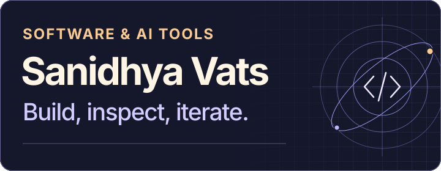

I build AI systems that can act, show their work, and hand control back to the user. My focus is coding agent runtimes, evaluations, and tools for editing video and voice.

[Portfolio](https://www.sanidhyavats.me/) · [LinkedIn](https://www.linkedin.com/in/sanidhya-vats-9344522b7/)

## GoHarness · Coding agent runtime

A local-first coding agent written in Go. It previews edits for approval, resumes sessions from a durable journal, and tells you whether it verified its work. Its evaluation runner grades changes in a clean copy of the task with hidden tests.

[Source](https://github.com/Sanidhya14321/goh) · [Architecture](https://github.com/Sanidhya14321/goh/blob/main/docs/ARCHITECTURE.md) · [Evaluation reports](https://github.com/Sanidhya14321/goh/tree/main/docs/bench)

<strong>See a GoHarness session and how it’s evaluated</strong>

The harness records what it verified during a run. The benchmark grades the resulting patch independently and tracks cases where the agent reported completion but the patch failed.

## AI for video and voice

**[ClipKit Studio](https://github.com/Sanidhya14321/clipkit-studio)** · A Rust-powered video editor that turns an agent’s decisions into reversible timeline edits. Watch the work in a browser studio, then take over and edit it yourself. [See what works today](https://github.com/Sanidhya14321/clipkit-studio/blob/main/VERIFICATION.md)

**[Undertone](https://github.com/Sanidhya14321/undertone)** · A Fish Audio voice studio and browser companion for directing expressive dialogue, auditioning voices, and transcribing recordings to subtitles. [Open the studio](https://undertone.vercel.app/studio)

<strong>See the Undertone workspace</strong>

