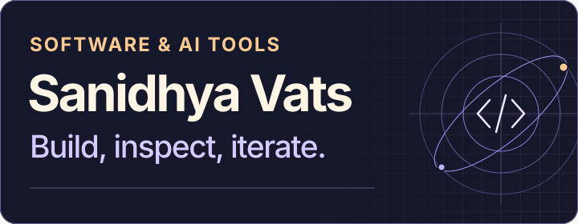

I build coding agents, retrieval systems, and AI applications for assessment, video, and voice. I focus on how these systems use tools, cite evidence, and verify their outputs.

[Portfolio](https://www.sanidhyavats.me/) · [LinkedIn](https://www.linkedin.com/in/sanidhya-vats-9344522b7/)

## Selected projects

### GoHarness · Coding agents and evaluation

A local-first Go coding agent with scoped tool approvals, recoverable sessions, and configurable checks that feed failures back into the agent loop. Its evaluation runner grades patches against hidden tests and tracks false completions.

[Repository](https://github.com/Sanidhya14321/goh) · [Architecture](https://github.com/Sanidhya14321/goh/blob/main/docs/ARCHITECTURE.md) · [Evaluation reports](https://github.com/Sanidhya14321/goh/tree/main/docs/benchmarks)

### ORGOS · Goal planning and handbook Q&A

Uses BullMQ workers to break organizational goals into tasks. Its handbook assistant retrieves policy passages scoped to the organization, cites its sources, and abstains when the retrieved evidence is weak.

[Repository](https://github.com/Sanidhya14321/ORGOS) · [Planning worker](https://github.com/Sanidhya14321/ORGOS/blob/8eef1c8543eaecf30efa209e73211c94f59a3b53/apps/api/src/queue/workers/decompose.csuite.worker.ts) · [Retrieval pipeline](https://github.com/Sanidhya14321/ORGOS/blob/8eef1c8543eaecf30efa209e73211c94f59a3b53/packages/agent-core/src/ragPipeline/runPipeline.ts)

### QuestionFlow · AI-assisted computer science assessments

Uses Groq to generate questions and recommend assessments. The app validates generated questions against a schema, grades submissions server-side, and saves results for review.

[Repository](https://github.com/Sanidhya14321/questionflow) · [Live app](https://questionflow.vercel.app/) · [Grading tests](https://github.com/Sanidhya14321/questionflow/blob/496e138a647a704b1a6cbecf7ed557a4344f51a6/tests/grade-assessment.test.ts)

### Video Forge · Agent-assisted video production

A toolkit for authoring short-form video as editable React compositions with Codex or Claude Code. Its local Remotion and FFmpeg pipeline renders previews and exports video and captions alongside editable source and a checksummed asset manifest.

[Repository](https://github.com/Sanidhya14321/video-forge) · [Rendered demo](https://github.com/Sanidhya14321/video-forge#see-the-motion) · [Release](https://github.com/Sanidhya14321/video-forge/releases/tag/v0.7.1)

### Undertone · Voice AI studio and browser companion

A Fish Audio studio for expressive speech, multi-speaker dialogue, and transcription with subtitle exports. On-device translation preserves speaker tags and lets users review translated text before synthesis on supported desktop Chrome setups.

[Repository](https://github.com/Sanidhya14321/undertone) · [Live studio](https://undertone.vercel.app/studio) · [Extension release](https://github.com/Sanidhya14321/undertone/releases/tag/v0.2.0-beta.1)
